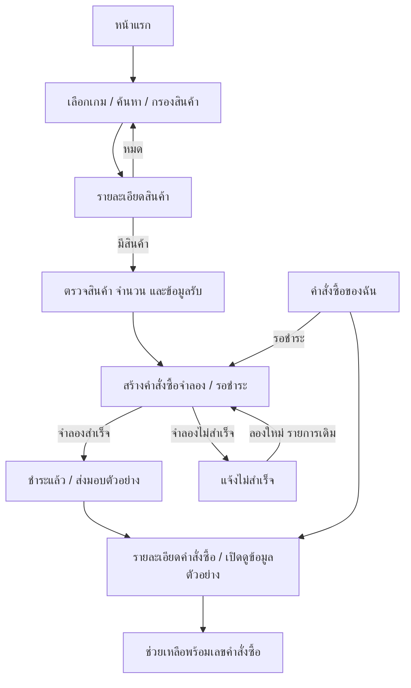

# SHOP-001 — UI Blueprint

สถานะ: ออกแบบครบตามขอบเขต พร้อมนำไปพัฒนา  
Branch: `design/shop-001-ui-blueprint`  
ขอบเขต: แบบหน้าจอและข้อกำหนด frontend สำหรับข้อมูลจำลอง ยังไม่มีโค้ดเว็บไซต์

## 1. ทิศทางภาพรวม

**แนวคิด: เล่นง่าย เลือกชัด ซื้อสะดวก** — ร้านเกมที่ให้ภาพสินค้าเป็นจุดเด่น ใช้พื้นกรมท่าเข้ม พื้นที่ว่างมาก และสีม่วงเฉพาะจุดที่ต้องการให้กด

ใช้ชื่อชั่วคราว **GAME SHOP** จนกว่าจะมีชื่อร้านจริง ภาษาไทยเป็นหลัก ราคาเป็นบาท รูปแบบ `฿1,290` ไม่แสดงยอดขาย รีวิว หรือคำรับประกันที่ยังไม่มีข้อมูลจริง

- Hero ใช้ภาพวัตถุเกมสามมิติหรือฉากนามธรรมหนึ่งภาพ แสงม่วงนุ่มและลายตารางจาง
- ภาพสินค้าต้องสื่อว่ากำลังซื้ออะไร ภาพไอดีแสดงแรงก์หรือรายละเอียดบัญชีจำลอง ภาพไอเท็มเน้นตัววัตถุ
- งดพื้นหลังเคลื่อนไหวตลอดเวลา เสียงอัตโนมัติ และแบนเนอร์สลับเอง
- ใช้ภาพ placeholder ที่ระบุชัดระหว่างพัฒนา ภาพจริงและสิทธิ์ใช้งานเป็นข้อมูลที่ต้องจัดเตรียมภายหลัง

## 2. Design Tokens

### สี

| Token | ค่า | ใช้งาน |
|---|---|---|
| Background | `#0B1020` | พื้นหลังหลัก |
| Surface | `#141B2D` | การ์ดและ Navbar |
| Raised surface | `#1C2640` | เมนู แผงตัวกรอง และ hover |
| Border | `#33415C` | เส้นแบ่งและขอบตกแต่ง |
| Control border | `#71809C` | ขอบ input ที่ต้องเห็นชัด |
| Text | `#F4F6FC` | หัวข้อและข้อความหลัก |
| Muted text | `#ABB8CE` | คำอธิบายและ metadata |
| Primary | `#7C3AED` | ปุ่มหลัก ใช้ตัวอักษรสีขาว |
| Primary hover | `#6D28D9` | ปุ่มหลักเมื่อ hover |
| Accent / focus | `#C4B5FD` | ลิงก์ เส้น focus และจุดเน้น |
| Success | `#6EE7B7` | สถานะพร้อมรับสินค้า |
| Warning | `#FCD34D` | รอชำระเงิน |
| Danger | `#FDA4AF` | ข้อผิดพลาดและสินค้าหมด |

สถานะต้องมีข้อความหรือไอคอนร่วมกับสีเสมอ ตรวจ contrast ในงานพัฒนา: ข้อความปกติอย่างน้อย 4.5:1 และองค์ประกอบควบคุม 3:1

### ตัวอักษรและขนาด

- ฟอนต์เป้าหมาย: Noto Sans Thai สำหรับไทยและข้อความทั่วไป; Geist สำหรับราคาและตัวเลข พร้อม sans-serif fallback
- Hero: desktop 48/60 px, mobile 32/44 px; หัวข้อหน้า 32/44 และ 28/40 px
- หัวข้อ section 24/34 px; body 16/26 px; metadata 14/22 px
- น้ำหนัก 400, 500, 600, 700; ชื่อสินค้าสูงสุดสองบรรทัดใน card และแสดงเต็มในหน้ารายละเอียด
- ไม่ลดราคาหรือข้อความปุ่มต่ำกว่า 16 px เพื่อบีบให้พอดี

### ระยะและกริด

- Spacing scale: 4, 8, 12, 16, 24, 32, 48, 64, 96 px
- Container สูงสุด 1200 px; desktop padding 32 px, tablet 24 px, mobile 16 px
- Desktop ตั้งแต่ 1024 px: grid 12 คอลัมน์ gap 24 px
- Tablet 768–1023 px: สินค้า 3 คอลัมน์; mobile ต่ำกว่า 768 px: 2 คอลัมน์ gap 12 px
- หน้ารวมสินค้ามี sidebar 240 px ที่ desktop และพื้นที่สินค้า 3 คอลัมน์; หน้าแรก desktop 4 คอลัมน์
- Card radius 16 px, input/button 12 px, badge แบบ pill; ขอบ 1 px และเงาเบา
- ปุ่ม/input สูงอย่างน้อย 48 px; พื้นที่กดไอคอนอย่างน้อย 44 × 44 px
- Section gap desktop 64 px, mobile 40 px; Navbar สูง 72/64 px

## 3. เส้นทางและ Navigation

| Route | หน้าที่ |
|---|---|
| `/` | หน้าแรก |
| `/products` | สินค้าทั้งหมด รองรับ `q`, `game`, `type`, `min`, `max`, `sort`, `page` |
| `/games/[slug]` | หน้าร้านเกม ใช้ catalog เดียวกันและล็อกเกมตาม route |
| `/products/[id]` | รายละเอียดสินค้า |
| `/login`, `/register` | เข้าสู่ระบบและสมัครสมาชิกจำลอง |
| `/login?mode=recovery` | ฟอร์มกู้รหัสผ่านจำลอง |
| `/checkout?product=[id]&quantity=[n]` | ตรวจสอบและชำระเงินจำลอง |
| `/orders`, `/orders/[id]` | ประวัติและรายละเอียดคำสั่งซื้อจำลอง |
| `/help`, `/help?order=[id]` | FAQ และติดต่อพร้อมเลขคำสั่งซื้อ |

Desktop Navbar: โลโก้ → เลือกเกม → สินค้าทั้งหมด → ช่องค้นหา → คำสั่งซื้อ → บัญชี  
Mobile Navbar: โลโก้ → ค้นหา → เมนู; เมนูรวมรายการนำทางและบัญชี เปิดเป็น drawer  
Footer: ชื่อร้าน คำอธิบายสั้น วิธีซื้อ เงื่อนไข และช่วยเหลือ; หัวข้อเงื่อนไขเชื่อม section ใน `/help`

การค้นหากด Enter แล้วไป `/products?q=...` ปุ่มย้อนกลับจากรายละเอียดรักษาตัวกรองผ่าน browser history

## 4. Wireframes ทั้ง 7 หน้าหลัก

แบบต่อไปนี้ระบุโครงสร้างและลำดับข้อมูล ไม่ใช่ภาพหน้าจอที่พัฒนาแล้ว
ทุกหน้ามี Navbar และ Footer ยกเว้นฟอร์มบัญชีที่ใช้หัวหน้าเรียบและลิงก์กลับร้าน

### 4.1 หน้าแรก

```text
DESKTOP 1440                         MOBILE 390
┌──────────────────────────────┐     ┌──────────────────┐
│ LOGO  เกม  สินค้า  ค้นหา บัญชี│     │ LOGO   ค้นหา เมนู│
├───────────────────┬──────────┤     ├──────────────────┤
│ ไอดีพร้อมเล่น     │ ภาพเกม   │     │ ไอดีพร้อมเล่น    │
│ ไอเท็มพร้อมลุย    │ abstract │     │ ไอเท็มพร้อมลุย   │
│ คำอธิบาย + CTA    │          │     │ คำอธิบาย + CTA   │
├───────────────────┴──────────┤     │ ภาพ hero         │
│ เลือกเกม [ A ][ B ][ C ][ D ]│     ├──────────────────┤
│ แนะนำ     [ทั้งหมด ไอดี ไอเท็ม]│   │ เลือกเกม A B →   │
│ [สินค้า][สินค้า][สินค้า][สินค้า]│   │ แนะนำ + แท็บ     │
│ ล่าสุด                ดูทั้งหมด│   │ [สินค้า][สินค้า] │
│ [สินค้า][สินค้า][สินค้า][สินค้า]│   │ ล่าสุด  ดูทั้งหมด│
│ เลือก → ชำระ → รับสินค้า     │     │ [สินค้า][สินค้า] │
│ Footer                       │     │ วิธีซื้อ / Footer│
└──────────────────────────────┘     └──────────────────┘
```

- CTA “เลือกซื้อสินค้า” ไป `/products`; แถวเกมเลื่อนแนวนอนได้บนมือถือพร้อมชื่อใต้ภาพ
- แนะนำและล่าสุดแยกกันชัดเจน ไม่ใส่ carousel สินค้าอัตโนมัติ
- ชุดข้อมูลว่างแสดง “กำลังเตรียมสินค้า” และลิงก์ช่วยเหลือ

### 4.2 รวมสินค้าและร้านแต่ละเกม

```text
DESKTOP                              MOBILE
┌──────────────────────────────┐     ┌──────────────────┐
│ Navbar                       │     │ Navbar           │
│ สินค้าทั้งหมด / ปกเกม        │     │ ชื่อเกม / ปกเกม  │
│ [ทั้งหมด][ไอดี][ไอเท็ม]       │     │ [ทั้งหมด ไอดี ไอเท็ม]│
├────────┬─────────────────────┤     │ ค้นหา            │
│ ตัวกรอง│ ค้นหา   จำนวน  เรียง│     │ กรอง(2)  เรียงราคา│
│ เกม    │ [สินค้า][สินค้า][สินค้า]│  │ ตัวกรองที่เลือก ×│
│ ราคา   │ [สินค้า][สินค้า][สินค้า]│  │ [สินค้า][สินค้า] │
│ ล้างค่า│ เปลี่ยนหน้า         │     │ [สินค้า][สินค้า] │
├────────┴─────────────────────┤     │ เปลี่ยนหน้า      │
│ Footer                       │     │ Footer           │
└──────────────────────────────┘     └──────────────────┘
```

- ค้นหาและตัวกรองทำงานร่วมกัน; sort: ล่าสุด, ราคาต่ำ→สูง, ราคาสูง→ต่ำ
- Mobile filter drawer: ตัวเลือก → ล้างค่า → “แสดงสินค้า”; ยังไม่เปลี่ยนผลจนกดยืนยัน
- เปลี่ยนตัวกรองแล้วกลับหน้า 1; แสดงจำนวนผลลัพธ์และ chips ที่ลบได้
- ไม่มีผลลัพธ์: “ไม่พบสินค้าที่ตรงกัน” พร้อม “ล้างตัวกรอง”
- เกมไม่พบใช้ not-found พร้อมกลับไปเลือกเกม ไม่แสดงร้านเกมว่างที่ดูเหมือนมีอยู่จริง

### 4.3 รายละเอียดสินค้า

```text
DESKTOP                              MOBILE
┌──────────────────────────────┐     ┌──────────────────┐
│ Navbar / Breadcrumb          │     │ Navbar / ย้อนกลับ│
├────────────────┬─────────────┤     │ ภาพหลัก          │
│ ภาพหลัก 4:3    │ เกม / ประเภท│     │ [ภาพย่อย 1 2 3] │
│                │ ชื่อสินค้า  │     │ เกม / ชื่อสินค้า │
│ [ภาพย่อย 1 2 3]│ สเปก/สถานะ  │     │ สเปก / สถานะ     │
│                │ ราคา จำนวน │     │ ราคา / จำนวน     │
│                │ [ซื้อเลย]   │     │ รายละเอียด       │
├────────────────┴─────────────┤     │ วิธีรับ / เงื่อนไข│
│ รายละเอียด / วิธีรับ / เงื่อนไข│    │ Footer + safe gap│
│ Footer                       │     ├──────────────────┤
└──────────────────────────────┘     │ ฿1,290 [ซื้อเลย]  │
                                     └──────────────────┘
```

- ไอดี: จำนวนคงที่ 1; ไอเท็ม: stepper ตั้งแต่ 1 ถึงสต็อก
- แสดงเกม เซิร์ฟเวอร์ และแรงก์เฉพาะที่เกี่ยวข้อง; ราคาอัปเดตตามจำนวน
- มือถือมี sticky purchase bar พร้อม bottom safe area และพื้นที่ท้ายหน้าป้องกันบังเนื้อหา
- สินค้าหมด: ปุ่ม disabled “สินค้าหมด”; id ไม่ถูกต้อง: not-found และ “ดูสินค้าทั้งหมด”
- แกลเลอรีมี alt text และปุ่มควบคุมที่ใช้แป้นพิมพ์ได้

### 4.4 สั่งซื้อและชำระเงิน

```text
DESKTOP                              MOBILE
┌──────────────────────────────┐     ┌──────────────────┐
│ ตรวจสอบ → ชำระเงิน → รับสินค้า│    │ ตรวจสอบ > ชำระ > รับ│
│ แถบแจ้งโหมดสาธิต             │     │ โหมดสาธิต        │
├─────────────────┬────────────┤     │ สรุปสินค้า / ยอด │
│ ข้อมูลรับสินค้า │ สรุปสินค้า │     │ ข้อมูลรับสินค้า  │
│ วิธีชำระจำลอง   │ จำนวน/ราคา│     │ วิธีชำระจำลอง    │
│ เงื่อนไข        │ ยอดรวม    │     │ เงื่อนไข         │
│                 │ [ยืนยัน]  │     │ ยอดรวม [ยืนยัน]  │
└─────────────────┴────────────┘     └──────────────────┘
```

- ข้อมูลรับสินค้าใช้ข้อมูลตัวอย่าง; ไม่เรียกชำระเงินจริงและไม่มี QR หรือเลขบัญชีจริง
- ยอดรวม = ราคาต่อหน่วย × จำนวน; รอบนี้ไม่มีคูปองหรือค่าธรรมเนียมแฝง
- ตรวจสินค้าและจำนวนจากชุดข้อมูลอีกครั้ง ไม่เชื่อยอดเงินจาก query string
- ไม่มีสินค้า/จำนวนไม่ถูกต้อง: แสดงข้อความพร้อมกลับไปเลือกใหม่
- หลังยืนยันสร้างคำสั่งซื้อจำลองหนึ่งรายการ แล้วแสดงแผงรอชำระพร้อมปุ่ม “จำลองสำเร็จ” / “จำลองไม่สำเร็จ”
- สำเร็จ: สรุปยอดและ “ดูคำสั่งซื้อ”; ไม่สำเร็จ: คำอธิบายและ “ลองใหม่” โดยใช้คำสั่งซื้อเดิม
- ปุ่ม loading กันกดซ้ำ; reload ต้องคืนสถานะจากข้อมูลคำสั่งซื้อจำลองที่บันทึกไว้

### 4.5 คำสั่งซื้อของฉัน

```text
DESKTOP                              MOBILE
┌──────────────────────────────┐     ┌──────────────────┐
│ Navbar / คำสั่งซื้อของฉัน     │     │ คำสั่งซื้อของฉัน │
│ [ทั้งหมด รอชำระ สำเร็จ ไม่สำเร็จ]│  │ แท็บสถานะ →      │
│ เลขที่ | สินค้า | ยอด | สถานะ│     │ #DEMO-001 สถานะ  │
│ #DEMO-001 ...      [ดูรายการ]│     │ รูป ชื่อ / ยอด   │
│ #DEMO-002 ...      [ดูรายการ]│     │ [ดูรายละเอียด]   │
└──────────────────────────────┘     └──────────────────┘

รายละเอียด desktop: [รายการสินค้า + timeline] [ยอดรวม + ข้อมูลรับ]
รายละเอียด mobile:  รายการ → สถานะ → ยอดรวม → ข้อมูลรับ → ติดต่อ
```

- Timeline: สร้างรายการ → รอชำระ → ชำระแล้ว → ส่งมอบตัวอย่างแล้ว
- ข้อมูลส่งมอบแสดงเฉพาะสถานะส่งมอบแล้ว ปิดบังเริ่มต้น มีปุ่มแสดง/ซ่อนและคัดลอก
- ใช้ค่าเช่น `DEMO-ACCOUNT` เท่านั้น; ปุ่มคัดลอกแจ้งสำเร็จหรือข้อผิดพลาด
- ไม่มีรายการ: “ยังไม่มีคำสั่งซื้อ” และ “เลือกซื้อสินค้า”; id ไม่พบ: กลับรายการ
- ติดต่อส่งต่อเลขคำสั่งซื้อไป `/help?order=...`; รายการรอชำระมีปุ่มดำเนินการต่อ

### 4.6 เข้าสู่ระบบและสมัครสมาชิก

```text
DESKTOP                              MOBILE
┌──────────────────────────────┐     ┌──────────────────┐
│ LOGO                กลับร้าน│     │ LOGO / กลับร้าน  │
│       ┌──────────────┐       │     │ เข้าสู่ระบบ      │
│       │ เข้าสู่ระบบ  │       │     │ โหมดสาธิต        │
│ แสง   │ โหมดสาธิต   │ แสง   │     │ อีเมล            │
│ จาง   │ อีเมล       │ จาง   │     │ รหัสผ่าน [แสดง] │
│       │ รหัสผ่าน    │       │     │ ลืมรหัสผ่าน      │
│       │ [เข้าสู่ระบบ]│       │     │ [เข้าสู่ระบบ]    │
│       │ สมัคร / กู้ │       │     │ สมัครสมาชิก      │
│       └──────────────┘       │     └──────────────────┘
└──────────────────────────────┘
```

- Desktop form กว้างสูงสุด 440 px; mobile เต็มพื้นที่ภายใน margin ไม่บังคับความสูง
- สมัคร: ชื่อแสดง อีเมล รหัสผ่าน ยืนยันรหัสผ่าน; ข้อผิดพลาดแสดงใต้ช่องและไม่ลบค่าที่กรอก
- กู้รหัสผ่าน: ช่องอีเมลและปุ่ม “จำลองการขอลิงก์” พร้อมผลว่าไม่ได้ส่งอีเมลจริง
- ใช้ข้อความให้กรอกข้อมูลสมมติ; ไม่บันทึกรหัสผ่านลง storage และไม่สื่อว่ามีการยืนยันตัวตนจริง
- รอบสาธิตอนุญาตซื้อแบบ guest; ระบบบัญชีไม่เป็นกำแพงขวางการทดสอบซื้อ

### 4.7 ช่วยเหลือ

```text
DESKTOP                              MOBILE
┌──────────────────────────────┐     ┌──────────────────┐
│ Navbar / ให้เราช่วยอะไรดี?   │     │ ให้เราช่วยอะไรดี?│
│ [ค้นหาคำถาม................]│     │ [ค้นหาคำถาม]     │
│ [วิธีซื้อ] [รับสินค้า] [เงื่อนไข]│  │ หมวดหมู่ →       │
├─────────────────┬────────────┤     │ FAQ accordion    │
│ FAQ accordion   │ ติดต่อ    │     │ ติดต่อ           │
│ คำถาม +         │ เลขออเดอร์│     │ เลขคำสั่งซื้อ     │
│ คำถาม - คำตอบ   │ ข้อความ   │     │ ข้อความ          │
│                 │ [ดูตัวอย่าง]│   │ [ดูตัวอย่างคำขอ] │
└─────────────────┴────────────┘     └──────────────────┘
```

- หมวดเงื่อนไขใช้ข้อความตัวอย่างที่ติดป้าย ไม่กำหนดนโยบายรับประกันแทนเจ้าของร้าน
- ผลค้นหาว่างเสนอการล้างคำค้น; accordion ใช้ปุ่มและประกาศ expanded state
- ฟอร์มแสดง preview คำขอพร้อมข้อความ “ยังไม่ได้ส่ง”; ช่องทางติดต่อจริงรอข้อมูลเจ้าของร้าน

## 5. ส่วนประกอบและ Interaction

| ส่วนประกอบ | ข้อกำหนด |
|---|---|
| ProductCard | ภาพ 4:3 → badge ประเภท → เกม → ชื่อ 2 บรรทัด → สเปกสั้น → ราคา/สถานะ; ทั้งการ์ดเป็นลิงก์เดียว |
| Button | primary สำหรับ action หลัก, secondary สำหรับทางเลือก, ghost สำหรับ action รอง; default/hover/focus/disabled/loading |
| Input | label คงอยู่, helper/error ใต้ช่อง, ไม่ใช้ placeholder แทน label |
| Tabs | สถานะ active มองเห็นได้ชัด มี keyboard navigation และชื่อที่อ่านได้ |
| Drawer/Modal | มีชื่อและปุ่มปิด, trap focus, Escape ปิดได้ และคืน focus ให้ปุ่มเดิม |
| Toast/status | แจ้งคัดลอกและผลการกระทำด้วย live region โดยไม่แย่ง focus |
| Skeleton | ขนาดเท่ากับเนื้อหาจริงเพื่อลดการขยับ; ไม่ใช้ shimmer เมื่อ reduced motion |
| Empty/error | มีข้อความเฉพาะกรณีและ action ที่ช่วยไปต่อ เช่น ล้างตัวกรอง ลองใหม่ หรือกลับร้าน |

Hover card ยก 2 px พร้อมขอบ accent 160 ms; ปุ่ม/แท็บ 120–180 ms; drawer 200 ms
ใช้ opacity/transform และปิด movement เมื่อ reduced motion; ข้อมูลสำคัญต้องมองเห็นโดยไม่ต้อง hover

## 6. เส้นทางใช้งานและข้อมูลจำลอง



- สินค้าจำลองต้องมีอย่างน้อย: ไอดีพร้อมขาย, ไอดีหมด, ไอเท็มหลายชิ้น และหลายเกมเพื่อทดสอบตัวกรอง
- Product: id, slug เกม, ประเภท, ชื่อ, ราคา THB, ภาพ, stock, server และ rank เฉพาะที่เกี่ยวข้อง
- Order: demo id, snapshot สินค้าและราคา, quantity, total, createdAt, paymentStatus และ deliveryStatus แยกกัน
- เก็บคำสั่งซื้อสาธิตใน local storage ที่มี version เพื่อให้เปิดดูหลัง reload ได้; ต้องมีทางล้างข้อมูลสาธิต
- เก็บเฉพาะข้อมูลสมมติ ไม่ใส่รหัสผ่านหรือข้อมูลส่งมอบจริง; frontend storage ไม่ใช่ขอบเขตความปลอดภัย
- สถานะข้อมูลเสียหรือ version ไม่ตรงแสดงข้อความให้รีเซ็ตข้อมูลสาธิต ไม่ทำให้หน้าพัง

## 7. Checklist ส่งต่อให้ SHOP-002

- [x] กำหนดแบบ desktop/mobile ครบทั้ง 7 หน้าหลัก
- [x] ระบุหน้าร้านเกม สมัครสมาชิก กู้รหัสผ่าน และรายละเอียดคำสั่งซื้อ
- [x] ระบุผลชำระเงินรอชำระ/สำเร็จ/ไม่สำเร็จและทางกลับไปดำเนินการต่อ
- [x] กำหนดสี ฟอนต์ spacing grid cards และ motion
- [x] กำหนด routes และเส้นทางซื้อครบตั้งแต่เลือกจนรับข้อมูลตัวอย่าง
- [x] ระบุ loading/empty/error/not-found และข้อกำหนด accessibility

การตรวจใน task นี้เป็นการตรวจเอกสารและความครบถ้วนของแบบ ยังไม่ได้ทดสอบ UI, contrast ที่ render จริง หรือ build แอป
ชื่อร้าน โลโก้ ภาพสินค้า ช่องทางติดต่อ และเงื่อนไขจริงยังเป็นข้อมูลที่ต้องเติมก่อนเปิดใช้งานจริง แต่ไม่ขวางการสร้าง UI จำลอง
